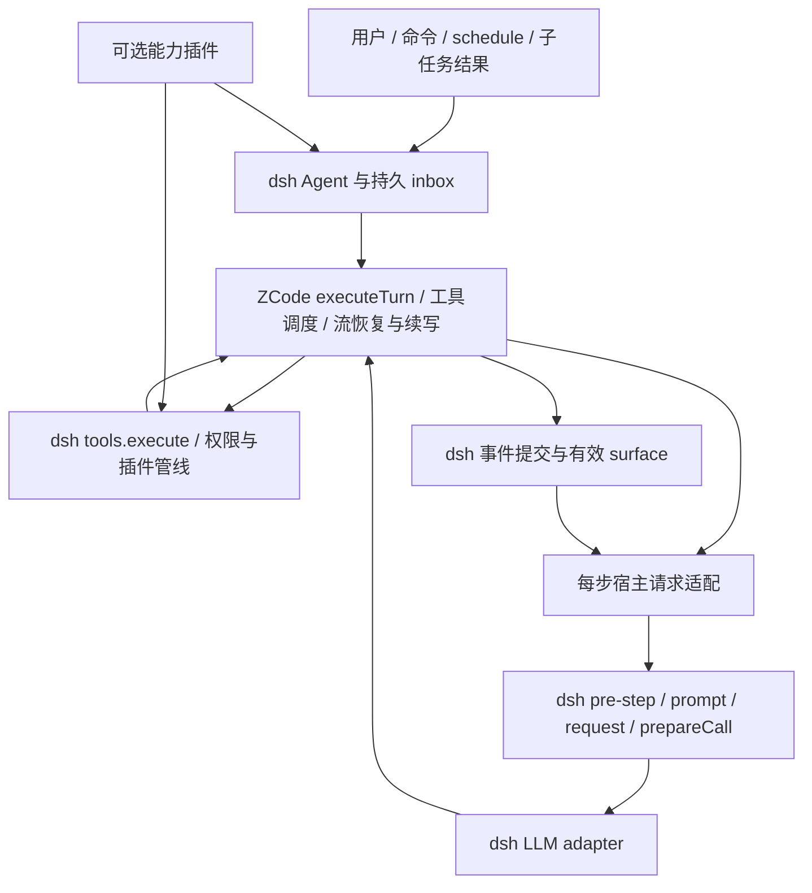

# ZCode 循环替换 dsh：完整接入计划与任务账本

基线：`e8ba89f`；分析日期：2026-10-17。ZCode 为仓库内 v3.15.1 快照，运行宿主为已安装的 `@deepseek-ai/dsh@0.2.1-alpha.5`。本文是当前节点的完整范围和待办，不是分阶段路线图。任务、能力判断和升级后的差异处理由 Codex 维护，用户不维护接口清单。

## 目标与完成定义

用 ZCode 的模型／工具循环替换 dsh 的 stock loop，保留 dsh 的插件、工具管线、会话、权限、交互及部署方式。选择实现量和后续升级改动较小的接法；同一项通用能力优先复用 dsh，缺少的用户功能通过本仓库插件补充。可靠性是需要故障场景验证的目标，不能由选用了 ZCode 或 mock 场景通过直接推出。

本计划有两个独立结果：

- **目标功能可用性**：下表全部 T01—T24 完成，所选择的行为在实际部署中有入口、能工作、能恢复，故障边界有证据。
- **ZCode 原生协议接入度**：继续列出未调用的原生 API 和有损映射；即使目标功能全部可用，也不把它改写为“ZCode 全量无损接入”。

“完整”指两边能力都有明确处置和任务归属，不是把 ZCode 桌面产品、云端服务和每个配置字段重新实现一遍。没有消费者的字段不要求新增按钮。独有语义仍保留差异，不能用一个同类插件名字销账。

## 重新核查的结论

1. 当前替换方向可保留：`src/index.ts` 注册 `AgentFactory`，`src/agent.ts` 调 `runtime.executeTurn`，模型走 dsh LLM，工具走 dsh `tools.execute`。无需重写循环，也无需修改两边上游代码。
2. 当前桥还不能称为完整的 dsh loop 替代。`agent/pre-step` 只在 claimed-turn 开头执行；模型桥没有派发 `agent/request` / `agent/request-error`。压缩、请求改写、重试及其他逐步插件因此缺少正常接缝。依据：`src/agent.ts:drain`、`src/bridges/model-bridge.ts:createDshModelBridge`；已安装 stock loop 和 compaction-basic 均消费这些事件。
3. 两套历史目前可能分离。ZCode 自动压缩已运行，dsh surface 没有对应替换；反向 dsh `/compact`、工具结果裁剪和图片卸载也没有让后续引擎请求采用新 surface。仅镜像日志和隐藏摘要不能解决这个问题。
4. 冷恢复目前扫描原始日志、只收 `source.kind === 'user'`，会跳过 goal/scheduler/工具注入和压缩摘要等上下文，也没有以当前有效 surface 为统一入口。普通 resume/fork 的已有验收不能覆盖这些路径。依据：`src/bridges/resume-adapter.ts:translateDshEventsToEngineMessages`。
5. 错误与取消尚有可靠性缺口：未结算工具可导致 durable log 读取失败；取消原因被包装为普通 Error，事件桥按 error 收尾；dispose 尚未调用引擎 `beginShutdown`。依据：`src/agent.ts:cancel`、`src/index.ts:dispose`、`src/bridges/event-store-bridge.ts:translateTurnError`。
6. dsh 的 in-process subagent 使用 `ctx.agents.create/resume`，理论上可直接继承本工厂，不必另接 ZCode 的原生 subagent。spawn、fork、续聊、结构化结果、取消和恢复仍需真实验证。dsh workflow 则已有脚本扇出能力，不能同时声称等价于 ZCode 的保存／修订／持久恢复／hole/escalation 协议。
7. 名词需要拆开：dsh `session-checkpoint-policy` 是持久化 flush 屏障，不是文件快照；browser-use/computer-use 注册服务不自带操作工具；普通 fork 不等于选区 side chat、同会话 rewind 或工作区回滚。
8. 上次 280 条来自声明、端口、配置和内建工具的混合扫描，43 组是人工语义判断。它能发现部分声明漂移，不能发现所有函数体行为变化。当前 shipped base/web 静态展开为 196 个插件条目，其中 186 个没有三个场景的触发证据；这些既不是 186 个缺失功能，也不能当作覆盖完成。

可读源码定位：dsh `reference/deepseek-harness/packages/core/agent-loop/`、`compaction/compaction-basic/`、`session/session-checkpoint-policy/`、`subagent/subagent/src/manager.ts`。运行真值仍是已安装 npm 包；reference 仅作导航，未安装的可选提供方不算已经可用。

## 接入结构与唯一责任方

| 责任 | 选择 | 实现约束 |
| --- | --- | --- |
| 模型↔工具执行、调度、输出续写、流恢复、异常防护 | ZCode | 保留其循环；不复制 turn-loop，不 monkey patch private 成员。 |
| provider、凭证、请求中间件、工具、权限、交互、MCP/skill | dsh | 所有执行经 dsh 公共管线；不能开放一套绕过权限的 ZCode 内建工具。 |
| 对外会话、持久 inbox、source、goal/todo/plan、子任务与命令 | dsh | 每项状态只有一个责任方；不并行开启 ZCode queue/target/todo 子系统。 |
| 有效模型历史与压缩 | dsh surface | 正常请求取已接纳的有效 surface；ZCode 执行状态不另作持久化真相。 |
| 自动／手动压缩、overflow recovery、工具结果裁剪、图片卸载 | dsh compaction 插件 | 完成 T02—T04 后关闭 ZCode 自动／微压缩，避免双份压缩。关闭前先证明 dsh 路径可用。 |
| ZCode 独有临时请求内容，例如输出续写指令 | 请求适配层 | 显式保留当次临时增量，不把全部引擎历史重新覆盖回 dsh，也不把临时内容当用户消息落盘。 |
| 特有用户能力 | 同一个包的可选插件入口 | 先复用现有 dsh provider；需要新入口时增加窄服务／工具／命令，不另建插件框架。 |
| 存储 | dsh log + 插件自有少量数据 | 插件数据仅放记忆、文件快照等 log 不能容纳的内容，使用稳定 ID 关联。 |

最重要的技术验证在 T02/T04：当前 `model_request` 事件早于实际 `Model.streamText/generateText`。需要把宿主消息／步骤的提交延后到宿主准入完成，不能在 stream wrapper 里补一个 waterfall 就算完成。使用既有 event-store、modelFactory 与 Agent 接缝组合；不把 `modelRequestAdmission` 当通用 pre-step hook（它是模型请求准入端口）。若公开接缝确实不能表达某一时序，保留阻塞项和复现，不能偷偷改 vendor 或宣称已兼容。

主步骤、传输重试和辅助调用也必须区分：dsh 插件决定请求改写与其请求失败恢复，ZCode 保留输出续写和流恢复；一次失败不能让两边无界重试。压缩摘要、标题与记忆提取不再次进入主会话 pre-step，不额外开 turn，也不污染 assistant surface。验收按实际 adapter 调用数、工具执行次数和提交的事件核对这些边界。

## 全部实施任务

状态均为 **待做**，责任人均为 **Codex**。既有实现和测试作为起点复用，不重复推倒。依赖是必要先后关系，不是需要逐次批准的阶段。下列拟新增文件、入口及命令尚未实现。

| ID | 最小实现与交付 | 依赖 | 完成证据 |
| --- | --- | --- | --- |
| T01 | **清单改为生成结果。** 保留 AST 枚举，补公共参数／结果引用类型、事件词表、实际 profile、注册面及所消费源码的变化快照。去掉手填逐字段 SHA 和手填 wiring 序号；旧／新快照机械比较。少量行为决策绑定本计划任务，场景旁声明覆盖对象。 | 无 | 加 API、改参数类型／实现体、增插件或事件均能产出待处理差异；行号变化不制造语义差异。新增项不会自动继承“已接”。 |
| T02 | **补每步请求接缝。** 第一及后续模型步骤执行 `agent/pre-step`，接纳后进入 `agent/request`、`prepareCall` 和实际 dispatch；请求失败进入 `agent/request-error`。保证 source、消息变换、startsRequestSeries、scope/initiator、取消与拒绝时序。复用 dsh 事件类型和 dispatch。 | 无 | 第 2 步插件能拒绝／修改请求；准入／prepare 取消不提交消息；重试不重复准入或工具执行；日志请求与实际 adapter 输入一致。 |
| T03 | **动态提示与运行时上下文。** 每步按 agent scope 装配 dsh prompt、AGENTS.md、preset、plan、环境事实；按实际 prepared route 处理提示更新和清空。保留引擎必要的当次续写内容。 | T02 | 同一 turn 改 prompt/plan/model 后下一步生效，清空后无旧指令；resume 后有效提示一致；无循环重复注入。 |
| T04 | **统一有效历史及压缩。** 新建、resume、fork 和请求都使用 dsh 当前 surface；保留所有有效 producer source、developer/context 和工具配对。补 `/compact`、逐步 pressure、overflow retry、pruner/offload；在这些路径通过后关 ZCode compact。空闲 surface 替换后经公开恢复接口刷新／重建 runtime；活动 turn 的实际请求从新 surface 派生。 | T02,T03 | 同 turn 工具结果增长触发压缩；下一请求、刷新、冷恢复和 fork 均只见新 surface。摘要不当终答；失败／取消不破坏事务；无重复 user 或 sidecar 污染。 |
| T05 | **错误、取消与持久性。** 配对结算未启动／结果未知工具，保留已交付文本、精确取消原因和终态；验证 flush 屏障在请求和副作用前生效。不得重试结果不明的副作用。 | T02 | adapter/工具/落盘失败及部分流后取消都可被 dsh 严格读取；崩溃恢复不重做未知调用；checkpoint flush 失败时正文未执行。 |
| T06 | **队列、维护及资源生命周期。** 对照 stock 处理 next-turn/next-step、send target、claim 原子边界、steer 拒绝回退、maintenance 与新输入竞态、create/setup 回滚、dispose/HMR 和写句柄释放；调用引擎 shutdown 并等待已拥有工作。高级暂停／恢复队列采用 dsh inbox 加最小插件状态，不再开第二个 native queue。 | T05 | 忙碌／维护／取消／卸载同时到输入不丢不重；恢复 pending 顺序一致；重复 dispose 和同 ID 重建不影响新 agent；暂停／恢复及编辑重排有真实入口。 |
| T07 | **模型与必要配置。** 换路由／推理档／maxTokens/defaults 与 dsh options 对齐；暴露有实际用途的 maxTurns、工具并发和 streaming 控制。预算、metadata 和能力开关取真实 adapter 值，不因一个端口存在就报支持。 | T02 | 第 2 步路由改写及恢复后档位符合 dsh 契约；上限和默认值不混淆；缺 adapter／缺能力有明确错误；小窗口和输出续写实际触发。 |
| T08 | **工具完整通路。** 去掉桥自带 120s/256KB 与 dsh policy 的冲突；根据实际调用参数判断并发安全，保持独占屏障；完整保留 content、contexts、进度、错误、附件和 spill 引用。工具增删／schema 更新每步可见，补 toolHistory。 | T02,T04,T07 | 长工具遵守配置；超大结果可回读；参数决定的并发与结果顺序正确；权限拒绝／超时／取消不旁路；动态工具变更实际 dispatch 与 header 相符。 |
| T09 | **dsh 扩展基础。** 验证全局和 preset scope、插件加载卸载、AGENTS.md、skill 发现与加载、MCP 工具/资源和文件／会话引用。复用已有服务，只修桥缺失。 | T03,T08 | 插件无需认识 ZCode 即可贡献提示、工具和上下文；sibling 不泄漏；动态 MCP/skill 变化进入下一请求；资源结果能继续被模型使用。 |
| T10 | **goal/todo/plan。** 复用三套 dsh 插件，覆盖续轮、预算／停止、工具 contexts、plan 进入退出与重启／fork；不启用 ZCode 第二套 target。 | T03,T04,T06 | 真实 goal 多轮直到终态；中止／失败不越权续轮；todo 与计划状态在恢复后仍与模型一致；不能只跑 happy path。 |
| T11 | **subagent 与侧聊。** 复用 in-process spawn/fork、continuation/control 和现有侧栏；证明子 agent 使用本工厂。补选区 side chat 命令：明确取已完成前缀及选区，创建独立 dsh 子会话。外部 provider 保持用户选定的引擎。 | T04,T06,T08,T09 | spawn/fork 区别正确；消息、取消、结构化结果、父子权限及冷恢复工作；选区子会话不混入父会话未完成工具。外部 SDK 子进程若未加载 patch，不得标为 ZCode。 |
| T12 | **workflow。** 复用 dsh workflow/PTC 与 subagent，补结果、进度、取消和作用域验证；模型目录／结构化交付使用 dsh 现有机制。 | T08,T11 | 脚本真实扇出多个 ZCode 子 agent 并汇总；失败／取消可收口；有可继续子会话。原生 DSL 的 run 修订／hole 等限制独立记录，见下文。 |
| T13 | **jobs/schedule/off-peak。** 复用 jobs、schedule 和源消息投递；补低峰调度策略及 create/list/cancel 命令，存储交给 dsh schedule。低峰按本地时段策略表达，不伪造云端优惠承诺。 | T04,T06,T08 | 创建、列举、取消、重启后的触发有效；结果回到正确 session/source；后台完成只通知一次；忙时投递不丢。 |
| T14 | **附件与媒体。** 打通图片从 inbox→有效历史→adapter→持久化／恢复及工具结果图片；通用文件用 dsh 文件引用和读取/转换服务。 | T04,T08 | 图片事实通过实际支持图片的 adapter 请求验证，换不支持的路由明确拒绝或走现有处理；恢复、fork、offload 不丢 ref。PDF/音视频原生输入限制继续显示。 |
| T15 | **插件的窄接缝。** 首个扩展确有需要时，在同一包增加按 dsh Agent 解析 runtime 的窄服务及创建／释放通知；让扩展走公共方法、工具和命令。不做通用 DI／能力框架，不开放任意 native 工具白名单。 | T06 | 非本工厂 agent 明确不支持；dispose 后无旧引用；插件卸载释放命令和监听。只访问 dsh 的扩展不依赖这个服务。 |
| T16 | **回退／编辑重跑入口。** 最小选择是从指定已完成边界派生新分支，编辑目标输入后重跑；复用 dsh seed/fork 和有效 surface，保留原分支及明确的 parent/target 标记。不直接截断既有 log。 | T04,T06,T11 | 目标前／后包含关系正确；goal/plan/todo/preset 派生状态符合分支规则；父会话仍可读可用；无文件回滚被暗中触发。与 same-session rewind 的差异在入口和统计中可见。 |
| T17 | **文件检查点与回滚插件。** 与会话 flush checkpoint 分开。对受管理文件记录写前快照、创建／删除和 hash，提供 list/preview/apply，先预检全部目标再应用并留恢复记录；与 T16 可组合，但不会假称两者跨进程原子。 | T05,T08,T15,T16 | 临时目录验证写/删/新增、冲突、权限、取消、部分应用故障及重启。仅回滚有快照且可验证的文件；任意 shell/外部程序未捕获的变化明确不可恢复，不能报告成功。 |
| T18 | **项目记忆插件。** 用 dsh 稳定 workspace 身份和存储根，轮后有界 extraction、下一请求召回注入；提示、模型与文件操作仍走 dsh。先做小型 memory 文件／索引、开关、查看／清空、并发写入和卸载收尾，不引入另一套会话库。 | T03,T04,T06,T08 | 会话 A 提取后 B 能召回；跨项目隔离、关闭禁用、失败不阻断主轮、重启后仍有效；回退旧分支不继续提取已舍弃内容。与 ZCode 原生 extraction/dream 算法不宣称相同。 |
| T19 | **workspace hooks。** dsh 生命周期、工具 pre/post、模型请求与取消作为执行接缝；补 hook 配置导入／映射、信任与 block 结果、提示注入和日志。只支持有确切对应语义的事件；未知 hook 类型拒绝而不是忽略。 | T02,T05,T06,T08,T15 | submit/start/tool/stop 类 hooks 各触发一次；block 阻止相应动作；取消终止进程；未信任内容不执行；不把普通 tools/pre-execute 当作全部 ZCode hooks 等价物。 |
| T20 | **浏览器/CUA/持久 JS。** 浏览器和桌面操作先装具体 dsh provider，不能只装注册服务；缺少持久 JS 时将已公开的 `NodeReplSession` 经 facade 包成 dsh 工具，所有调用通过 dsh 管线。按 session 隔离、关闭和清理。 | T06,T08,T09,T14,T15 | 真实 provider 至少完成一项读取与一项操作；JS 跨调用持久、跨会话隔离；图片返回可见；取消/卸载清理。CI 用 mock，容器/宿主的原生能力分开验收。 |
| T21 | **上下文引用、产物与诊断。** plugin/file/session 引用映射 dsh 资源和引用插件；产物/频道投递用 dsh 能力；日志和 request/step/trace 关联映射到 dsh 诊断。sample/connectivity 等宿主辅助调用复用 dsh llm，只有出现消费者时才新增命令。 | T02,T08,T09,T14 | 资源读取到模型上下文；有来源的结果能回溯；未知引擎事件被独立报告；日志/trace 可定位同一请求，但不宣称接通 ZCode 原生 collector/UI 协议。 |
| T22 | **部署与设置。** headless/web/SDK-minimal 及进程内子 agent 都只有一个 loop factory；插件可选入口按需启用；dsh loop 设置页能配置已支持字段，旧 stock 专属设置不能静默无效。 | T07,T09,T15 | 实际 loader 配置与运行注册一致；create/resume、插件卸载和重载可用；headless、SDK、web 各跑代表性任务；用户凭证与配置保留。 |
| T23 | **验收与状态生成。** 扩充现有 stock 双跑；dsh 有同类行为的按 consumer 断言对照，ZCode 独有行为用行为规格／故障注入。实际 activation、入口、运行证据、限制及任务状态分别展示。 | T01；随 T02—T22 一同补证据 | 下文全部验收族有结果；未知差异失败，已知未实现保持 open，缺环境显示未验收；不会因 3 场景或清单分类完整显示“全部接入”。 |
| T24 | **升级工具与演练。** 固定快照来源／版本／依赖，生成源码与接口差异，只改 facade 和必要桥件；保存 session/profile/config 在隔离副本完成兼容演练，失败可回到旧构建和旧数据。 | T01,T22,T23 | 实际换一份可获得的不同 ZCode 快照并运行门禁；若无候选快照，只能记“演练未完成”，不能以修改版本号替代。用户无需手改接口表和哈希。 |

接下来可直接开始 T02 的第 2 步拦截／取消探针及 T04 压缩前后请求探针：它们决定替换是否可靠，也决定后续插件能否复用。T01 只做支持这些工作的最小生成改造，不再先扩大统计系统。

## 现有 43 个分组的完整处置

这是对现存扫描的交叉索引，不是新的手填字段清单；当前实现状态仍由源码和证据决定。下表不提前把计划当完成。

| 现有分组 ID | 目标责任方／处置 | 任务 |
| --- | --- | --- |
| turn-entry | 保留 ZCode 循环，补完整宿主步骤与失败边界 | T02,T05,T06 |
| model-selection | dsh 路由与元数据 | T07 |
| system-context | dsh 动态 prompt／cwd／事实 | T03 |
| tool-registration | dsh 工具注册，每步刷新 | T08,T09 |
| event-persistence | dsh 有效 surface 与持久化 | T04,T05 |
| logger | 保留现有日志适配并关联请求 | T21 |
| core-internal | ZCode 内部执行；getter 不是待造 UI 功能 | T05,T23 |
| default-policy | ZCode 调度／执行默认值，验证 dsh 工具元数据 | T07,T08 |
| queue-alternative | dsh inbox，不启第二队列 | T06 |
| queue-advanced | 用 dsh inbox 加暂停／恢复，native reservation 协议不复制 | T06 |
| compact-command | dsh `/compact` | T04 |
| compact-policy | dsh 压缩策略；关闭 native 压缩避免冲突 | T04,T07 |
| runtime-policy-knobs | 暴露有实际用途的运行限制；不承诺透传全部配置 | T07,T08 |
| rewind | 分支回退／编辑重跑；same-session 原生协议保留未接入 | T16 |
| checkpoints | 文件快照插件，与 flush 屏障分开 | T17 |
| special-forks | 普通／选区／目标边界分支，文件分支由快照组合 | T11,T16,T17 |
| project-memory | dsh 项目记忆插件；原生算法/存储格式不复制 | T18 |
| permission-alternative | dsh permission/sandbox/plan | T08,T10 |
| goal-alternative | dsh goal/todo，不开 native target | T10 |
| subagent-alternative | dsh spawn/fork/control；本工厂驱动进程内子级 | T11 |
| actor-protocol | dsh 结构化子任务结果；native coordinator/escalation 未接入 | T11,T12 |
| workflow-alternative | dsh workflow/PTC | T12 |
| workflow-native | 通用编排由 dsh 承担；原生 DSL 保存/修订/持久 run/hole 不在本次替换实现范围 | T12，独有差异保留 |
| background-alternative | dsh jobs/schedule/terminal | T13 |
| off-peak | 本地低峰调度策略插件；云端权益协议不支持 | T13 |
| skill-mcp-alternative | dsh skill/MCP | T09 |
| tool-alternatives | dsh fs/bash/search/web/ask-user 与对应策略 | T08,T09 |
| media-native | 图片及文件读取/转换/产物走 dsh；原生音视频/PDF 块仍不支持 | T14,T21 |
| browser-cua-repl | 具体 dsh provider + 必要时公开 NodeReplSession 包装 | T20 |
| workspace-hooks | 插件映射，未支持事件显式拒绝 | T19 |
| telemetry | dsh 诊断可用；ZCode 专用 collector 不接 | T21 |
| trace-projection | 映射关联；不复刻 ZCode 桌面 trace/span 投影 | T21 |
| prompt-alternative | dsh 指令／persona／style/context | T03,T09 |
| title-alternative | dsh title/rename；验证 create/resume/fork | T22,T23 |
| auth-alternative | dsh adapter 凭证／刷新 | T07,T23 |
| host-model-utilities | dsh llm；无消费者的方法不新建入口，逐步 middleware 归 T02 | T02,T21 |
| session-host-metadata | 映射 dsh 已有身份／父子／workspace/source；ZCode 桌面/远程身份不伪造 | T06,T11,T21 |
| input-source-alternative | 原始 source、contexts 与历史保真 | T02,T04,T13 |
| execution-overrides | dsh agentOptions/preset/工具可见性与必要配置 | T07,T09 |
| host-lifecycle | dsh 所有权＋引擎 shutdown；桌面前台租约无消费者 | T06 |
| native-observers | 事件映射／观测，不为每个 record/getter 新建按钮 | T21,T23 |
| plugin-protocol | dsh 插件／引用／资源，ZCode 专属 PluginUi 应用协议不接 | T09,T21 |
| mid-system-policy | 依实际 dsh prepared route 协调提示 | T03,T07 |

扫描还需补入这 43 组以外的宿主契约：`agent/request(-error)`、逐步 middleware、动态 system/context、toolHistory、有效 surface、附件和取消／持久性。T01/T23 同时包含两边责任面，不再只以 `AgentRuntime` 的字段作为任务来源。

## 有意差异与明确不承诺的原生语义

以下判断由本目标的实现成本与宿主选择得出，不是既有未接入项被证明已经等价。报告要逐项展示“目标行为的替代路径”及“原生语义仍未接入”，不能共用一个绿色状态。

| 差异 | 明确决定 | 原因与边界 |
| --- | --- | --- |
| 工具名、内建 queue/target/todo/permission/MCP/title | 采用 dsh 实现，native 子系统关闭 | 避免两套权限、队列和状态；行为需按任务验收。 |
| 自动／微压缩算法 | 采用 dsh compaction 家族 | 复用持久 surface 事务、手动入口、裁剪和图片策略；不保留两份互相不可见的压缩。 |
| rewind | 支持新分支重跑，暂不提供同 ID 原地 rewind | 任意截断会遗留其他插件的 goal/plan/inbox 状态；新分支复用 dsh 有效 seed，成本较小。调用方需知道返回了新会话。 |
| 文件 rollback | 仅保证已捕获且预检通过的文件 | 不能恢复未记录的 shell、外部程序、远程服务副作用；不是“整个工作区任意时间恢复”。 |
| 记忆 | 自动提取／召回功能由插件提供 | 不接 ZCode 私有 memory helpers，不复刻 dream、原生存储与候选筛选全部策略。 |
| native dynamic-workflow、typed coordinator、hole/escalation | 原生协议未接入；通用编排／结构化结果用 dsh | 这是另一套编排产品，搬入完整 bootstrap/运行存储会显著扩大升级维护面。不能把 dsh workflow 声称为原生 run 恢复和修订。 |
| browser/CUA | 用具体 dsh provider，必要时补持久 JS | 不承诺兼容 ZCode 浏览器注入的全部对象/API；只有 registry 无操作能力时仍算缺入口。 |
| 原生媒体与结构化输出 | 支持 dsh 已有通路和工具式替代 | 图片需补；PDF/音视频原生 provider 块、native JSON-schema/web-search 关闭，插件可用的文件转换单独验收。 |
| ZCode PluginUi、desktop-continuous、remoteSession/前台提升租约、专用 telemetry 云端协议 | 不接这些宿主协议；保持列出限制 | dsh 宿主有自己的插件、UI、身份、所有权和诊断契约。当前缺消费者，也不是 loop 替换的前提。 |
| 流切片、内部诊断事件、服务名、引擎必要的临时续写 | 允许有依据的差异 | 联合文本、工具调用、终态、权限、副作用和恢复必须正确；不能笼统允许事件丢失或排序变化。ZCode identity 前缀是否保留，以 T03 实际请求和 dsh persona 一致性决定。 |

上述范围以外的新能力先标待处理，Codex 根据升级差异新增任务或记录不适用理由。不得按名称自动映射，不得把未加载提供方算替代，不得批量刷新哈希掩盖行为变化。

## 自动发现与维护工作量

不要求统计脚本理解全部语义。最小方案把机械工作交给脚本，把变化后的判断和实施交给 Codex：

1. **输入自动收集**：当前 vendor 的公开入口／事件／工具／相关类型和所消费实现文件，dsh 实际加载 profile、公共 Agent/Inbox 契约、注册面、关键扩展事件及有效配置。静态 shipped profile 与实际启用状态分别记录。
2. **结果自动生成**：入口位置、版本／源码差异、接线、场景证据、无场景项、未处理变化。逐字段 SHA 不再作为手工数据；只保存脚本生成的旧快照。
3. **语义决策少量保留**：本计划的责任方、限制和任务归属由 Codex 维护；不要再复制出 Markdown、JSON、测试三份独立状态。场景证据由运行结果生成，运行结果不能自动证明所有代码路径。
4. **变化分流**：新增／删除／签名变化需要处置；实现体变化进入升级报告并跑相关行为测试；行号／格式变化只是导航变化。无法定位影响时显示待处理，不能静默略过。
5. **两类 oracle**：dsh 插件的既有行为由同版本 stock/consumer 对照；ZCode 的续写、恢复、异常防护等用引擎行为规格及可复用上游测试。没有相同能力的 stock 不能充当该功能的正确性 oracle。
6. **三个状态分开**：检查是否执行成功、目标功能是否验收、原生能力差异是否仍存在。退出 0 不再被描述成全量完成。严格交付门禁拒绝未做任务、未知变化和要求范围内的未验收项。

“不用用户维护”不等于没有维护，也不等于自动升级永远零改动。每次升级由 Codex 查看自动报告、修必要桥件、运行验收、更新任务与说明；用户只提供目标和必要的环境／产品决定。

## 验收族与最终交付

现有脚本复用；新增场景只围绕实际责任边界，不为每个 getter 写测试。每项任务提交时更新证据，最终合并运行这些验收族：

| 验收族 | 至少触发的真实路径 |
| --- | --- |
| 循环可靠性 | 多步工具；并行与独占；输出上限续写；流断开／恢复；异常流；模型失败与插件重试；取消保留已显示文本；未知副作用不重做。 |
| 请求和插件 | 第 2 步准入／拒绝／改写；prompt/plan 变更及清空；adapter 切换；凭证刷新；工具热增删；scope/initiator；header/context/toolHistory 与实际请求。 |
| 历史和压缩 | 自动、手动、overflow、pruner、图片 offload；同 turn 后续请求；goal/scheduler/context 来源；严格落盘重读；resume/fork 与原有效 surface 一致。 |
| 生命周期 | pending 队列编辑／暂停／恢复；steer 与 idle/maintenance 竞态；setup 失败；工具执行中卸载；HMR；写句柄互斥；flush 失败／崩溃。 |
| dsh 用户功能 | goal/todo/plan；fs/bash/web/ask-user；skill/MCP/引用；subagent spawn/fork/control/side；workflow；jobs/schedule；附件；title/rename 与现有设置。 |
| 新插件 | 分支重跑；文件快照预检与恢复；项目记忆提取与召回；hooks 的 block/cancel；低峰调度；实际 browser/CUA provider 和持久 JS。 |
| 部署与升级 | headless/web/SDK；进程内子 agent；真实 loader 有效配置；隔离升级；旧 session 可读可续；一份不同 ZCode 快照的实际演练。 |

必须保留有意义的负向证据：删掉一个必要接线、让第 2 步拒绝失效、忽略 surface 替换或丢掉一个 source，验收都应失败。不能只验证“场景名称出现在矩阵”。无需强行让所有 196 个静态 profile 条目各拥有独立模型测试；无 loop 交互的 UI/基础设施插件记录依赖和可达性边界，跨接缝的功能有真实 consumer 场景。

最终交付包括：可运行插件与可选入口、可重跑的验收命令、生成的能力/差异报告、任务证据、升级操作和回退说明，以及临时容器里的带 token dsh 访问链接。原生桌面功能在宿主独立验收；容器 mock 通过不能冒充原生操作通过。

## 维护约定

- 本文是当前范围与待办的单一入口。历史 `CAPABILITIES.md`、`GAPS.md`、`PROJECTION.md` 仍保存现状证据，但其中“原型排除／按需评估”不再决定后续范围。
- `scripts/contract-verification/capabilities.json` 暂时保持当前基线；T01 将迁移它，不能先删除导致现有门禁失效，也不能把未来映射提前写为当前状态。
- Codex 完成任务时写明变更、执行证据、剩余限制并更新状态。既有部分验收只为其实际覆盖的边界计数。
- 用户本次请求是重新分析并制定计划；本文落地不表示 T01—T24 已执行，也不启动无关功能开发或长 review 流程。
